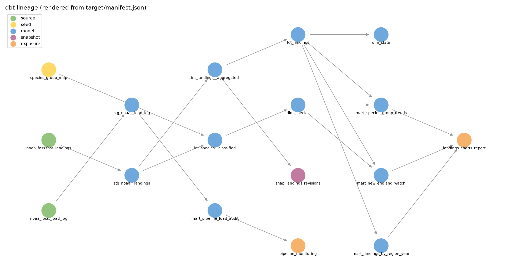
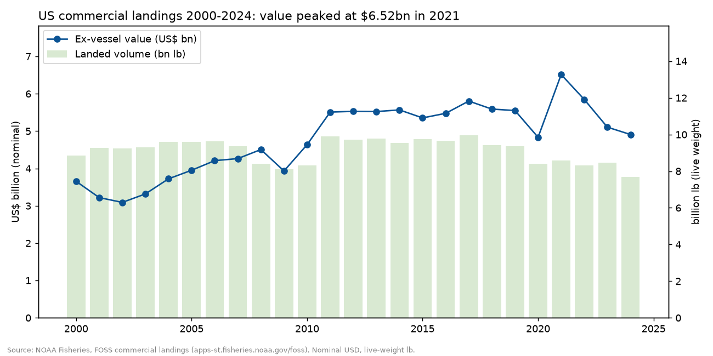
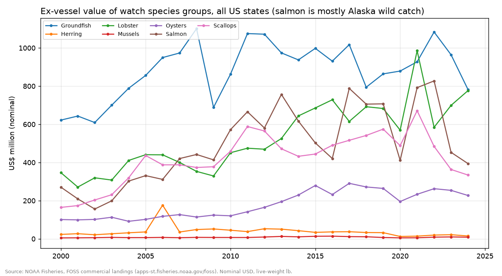
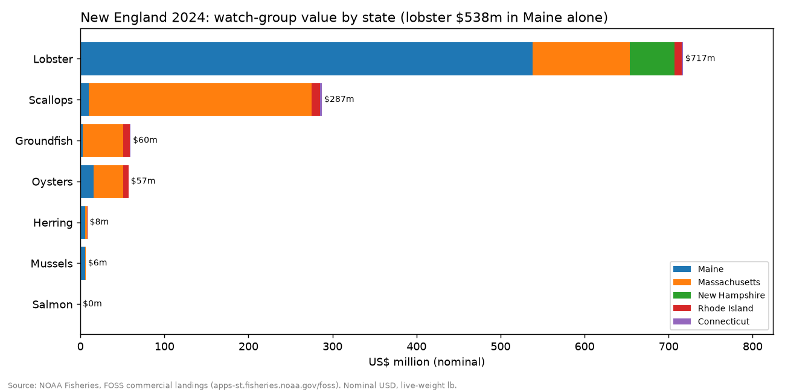
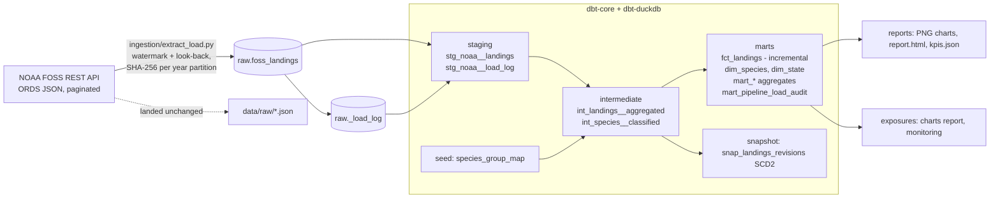

# US Seafood Landings ELT: Python ingestion + dbt on a DuckDB warehouse

**An end-to-end ELT pipeline on real NOAA Fisheries data.** An incremental, idempotent Python loader lands 25 years of US commercial landings (79,307 records) into a `raw` schema. dbt models them through staging, intermediate and marts layers with tests, a snapshot, freshness checks, docs and exposures, and the marts feed charts and an HTML report.

Personal portfolio project by **Amir Khan**, built to practise the modern data-stack pattern (managed-connector-style EL + dbt + cloud warehouse) used by seafood and aquaculture data teams.



## What it answers
1. How have US commercial landings (value and volume) moved over 2000-2024?
2. Which species groups relevant to an Atlantic seafood business (lobster, scallops, salmon, herring, groundfish, oysters, mussels) carry the value?
3. How concentrated is New England (Gulf of Maine) seafood value by state and species?
4. Is the pipeline healthy: when did each partition last load, did anything fail, and what changed?

## Headline numbers (generated from `reports/kpis.json`)
| Metric | Value |
|---|---|
| US commercial landings value, 2024 | **$4.91 bn** (nominal ex-vessel) |
| Landed volume, 2024 | 7.68 bn lb (live weight) |
| Peak value year in the series | 2021 ($6.52 bn); 2024 is -24.7% vs peak |
| Value in 2000 | $3.66 bn |
| American lobster, 2024 | $720 m, 14.7% of US value (the single most valuable species) |
| Maine American lobster, 2024 | $538 m from 87.5 m lb |
| Sea scallop, 2024 | $332 m |
| New England share of US value, 2024 | 28.4% ($1.39 bn) |
| American lobster price, 2000 → 2024 | $3.61 → $6.35 per lb (nominal) |





A self-contained summary is in [`reports/report.html`](reports/report.html).

## Architecture


| Layer | What happens |
|---|---|
| **EL** (`ingestion/extract_load.py`) | One API call per year (ORDS pagination followed). Each year partition is normalised, sorted and SHA-256 fingerprinted. **Incremental:** the watermark (max year loaded) decides new years; a 2-year look-back re-checks recent years because NOAA revises them. **Idempotent:** an unchanged hash is skipped; a changed one is replaced with DELETE + INSERT in one transaction. Every attempt (inserted / replaced / unchanged / empty / failed) is logged to `raw._load_log` with run id, rows, hash, URL and UTC times. A failed year is logged, the run continues, and the job exits non-zero. Re-running right after the first load logged `unchanged` for 2023-2024 and loaded 0 rows. |
| **Staging** | Rename, type, trim; strip NOAA's `**` grouped-record marker; flag confidential rows; keep the publisher ROWID for lineage. |
| **Intermediate** | Collapse duplicate sub-records to one row per year × state × species × source; fill missing regions from the state; classify species with a seed. |
| **Marts** | `fct_landings` is an **incremental** model (`delete+insert` on `landing_key`, re-processing the look-back years). Dimensions, region / species-group / New England marts with window functions (share of year, YoY, 5-year rolling average), and a pipeline load-audit mart. |
| **Snapshot** | `snap_landings_revisions` (check strategy, SCD2) records NOAA revisions to published figures over time. |
| **Macros** | `surrogate_key` (portable md5 via `dbt.hash`/`dbt.concat`), `safe_divide`, `clean_species_name`, `generate_schema_name`, generic tests `non_negative`, `value_between`, `dbt_utils_free_unique_combo`. |
| **Exposures** | `landings_charts_report` (analysis) and `pipeline_monitoring` (dashboard). |

## Data
- **Publisher:** NOAA Fisheries, Office of Science and Technology, *Fisheries One Stop Shop (FOSS)*: https://www.fisheries.noaa.gov/foss
- **Endpoint:** `https://apps-st.fisheries.noaa.gov/ods/foss/landings/?q={"year":YYYY,"collection":"Commercial"}` (public, no key). US federal government data, public domain.
- **Scope:** commercial landings, 2000-2024 (2024 is the latest year published as of Oct 2026), 32 states, 1,166 species/name codes. Pounds are live weight; dollars are **nominal** ex-vessel value.
- **Why NOAA and not DFO/FAO:** NOAA FOSS has a stable, scriptable JSON API with pagination, which suits an incremental loader. The DFO and FAO FishStat downloads are file-based releases. A Canadian (DFO) source would be the natural second connector (see Limits).

### Data issues found (kept and tested, not silently dropped)
- **Duplicate sub-records:** 3,420 business keys have more than one source record (e.g. 42 confidential rows for Hawaii in one year). They are summed in `int_landings__aggregated`, and `assert_fct_reconciles_to_raw` proves the yearly totals still equal raw.
- **Negative values:** 15 records (all ACCSP, Atlantic states, 2007-2022) carry small negative pounds or dollars, i.e. adjustments. They are kept so totals match NOAA and pinned by `assert_negative_adjustments_pinned`.
- **Missing region:** 15 records have no region. It is filled from the state's most frequent region, with `Unknown` as the fallback.
- **Missing value:** 19,627 records have pounds but no dollar value.
- **Confidentiality:** "WITHHELD FOR CONFIDENTIALITY" rows reach at most 3.4% of a year's value. A guardrail test fails above 10%.
- **Alaska** is published at a coarse grain (few, large rows), so per-row counts by region are not comparable.

## Tests
- **dbt:** 46 data tests (generic: unique, not_null, relationships, accepted_values, custom `non_negative` / `value_between` / unique-combination; 6 singular tests: raw-to-fact reconciliation, the two marts agree on totals, no year gaps, confidential-share guardrail, pinned negative adjustments, latest load not failed). Source freshness checks on both raw tables (warn 35 days, error 120 days).
- **pytest:** unit tests for the loader (initial load, idempotent re-run, watermark + look-back, replaced partition with no duplicates, order-independent hash, failure logging and retry, URL and ROWID parsing) plus a README-vs-KPI drift test.
- **CI:** `.github/workflows/ci.yml` runs pytest, ingestion (last 5 years), freshness, `dbt build` and `dbt docs generate` on DuckDB. It has not yet run on GitHub.

## Run it
```bash
./run.sh            # creates .venv from pinned requirements.txt, then: pytest -> EL -> freshness -> dbt build -> docs -> report
./run.sh --offline  # skip ingestion and rebuild from the existing warehouse.duckdb
.venv/bin/dbt docs serve --profiles-dir .   # browse docs + lineage
```
Requires Python 3.13 and internet access to the NOAA API (about 1 minute for the first full load).

## Snowflake portability
SQL uses cross-database constructs (`dbt.hash`, `dbt.concat`, `split_part`, `nullif`, window functions, `delete+insert` incremental). A Snowflake target is provided in [`profiles.snowflake.example.yml`](profiles.snowflake.example.yml). **Verified on DuckDB only. It has not been run on Snowflake.**

## Honest limits
- Local DuckDB stands in for a cloud warehouse. The loader is plain Python in the style of Fivetran/Boomi connectors; neither tool was used.
- FOSS landings are **wild-capture commercial** landings. They do **not** include aquaculture (farmed salmon) production, so salmon here is mostly Alaska wild catch and New England salmon is about $0.
- Dollars are nominal (no inflation adjustment). 2024 is the latest year available; NOAA may still revise 2024 figures.
- The snapshot has one version per key so far: no NOAA revisions occurred between local runs. Revision handling is exercised by the pytest `replaced` case.
- Species groups come from a hand-made seed keyed on the first word of the common name (e.g. all `COD`, `HAKE`, `FLOUNDER` → Groundfish).
- Possible next steps: a DFO (Canada) source, Snowflake run, dbt unit tests, sqlfluff.

## Reference repos studied (and what was borrowed)
| Repo | Borrowed |
|---|---|
| [dbt-labs/jaffle_shop_duckdb](https://github.com/dbt-labs/jaffle_shop_duckdb) | dbt + DuckDB with a project-local `profiles.yml` and "clone → one command → docs" setup; staging `schema.yml` style |
| [dbt-labs/jaffle-shop](https://github.com/dbt-labs/jaffle-shop) | `models/staging` + `models/marts` layering with per-model YAML, `__sources.yml`, the `generate_schema_name` macro pattern, a CI workflow on PRs |
| [josephmachado/simple_dbt_project](https://github.com/josephmachado/simple_dbt_project) | A Python EL script feeding dbt with incremental new data, an SCD2 snapshot, exposures, and a singular row-count reconciliation test |
| [dbt-labs/dbt-utils](https://github.com/dbt-labs/dbt-utils) | Semantics of `generate_surrogate_key` and `unique_combination_of_columns`, re-implemented as local macros so no package install is needed |
| [calogica/dbt-expectations](https://github.com/calogica/dbt-expectations) | The idea of range and value-expectation tests (`value_between`, `non_negative`) |

## Tools
Python 3.13 · requests · DuckDB 2.0 · dbt-core 1.12 · dbt-duckdb 1.11 · pandas · matplotlib · networkx · pytest · GitHub Actions (written)

## Author
Amir Khan · GitHub [@amirator](https://github.com/amirator)
